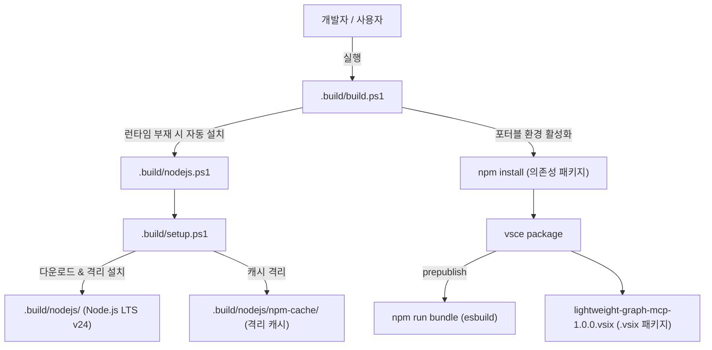

# lightweight-graph-mcp 포터블 빌드 가이드

이 디렉터리(`.build/`)는 호스트 시스템에 Node.js나 npm이 설치되어 있지 않아도, 독립된 포터블 런타임을 내려받아 프로젝트를 빌드하고 VS Code 확장 프로그램(`.vsix`)을 생성할 수 있는 환경을 제공합니다.

---

## 1. 빌드 흐름 (Architecture)



---

## 2. 파일 구성

| 파일/디렉터리 | 종류 | 설명 | Git 관리 여부 |
|---|---|---|---|
| `build.ps1` | 스크립트 | **원클릭 빌드 스크립트** (런타임 + 의존성 + 번들 + .vsix 패키징) | 추적 |
| `npm.cmd` | 배치 | **포터블 npm 러너** (Build Instructions 4개 방식 포터블 실행) | 추적 |
| `nodejs.ps1` | 스크립트 | Node.js 런타임 전용 어댑터 Facade | 추적 |
| `nodejs.sh` | 스크립트 | Linux/Bash 호환 어댑터 | 추적 |
| `setup.ps1` | 스크립트 | Portable Build Kit 핵심 엔진 | 추적 |
| `activate.ps1` | 스크립트 | 현재 PowerShell 세션에 포터블 환경변수 주입 | 자동생성 (추적 제외) |
| `nodejs/` | 디렉터리 | 포터블 Node.js/npm 바이너리 및 격리 캐시 | 자동생성 (추적 제외) |
| `_state/` | 디렉터리 | 설치 다운로드 임시 디렉터리 | 자동생성 (추적 제외) |

---

## 3. 사용 방법 (Usage)

### 3.1 포터블 npm 직접 사용 (.build\npm.cmd)
README의 **Build Instructions / 빌드 방법** 4개 명령을 포터블 격리 환경에서 그대로 실행할 수 있습니다:

```cmd
:: 1. 의존성 설치
.build\npm.cmd install

:: 2. esbuild 번들링 (dist/ 생성)
.build\npm.cmd run bundle

:: 3. jest 단위 테스트 실행
.build\npm.cmd test

:: 4. VSIX 확장 프로그램 패키징
.build\npm.cmd run package
```

### 3.2 원클릭 VSIX 빌드 (build.ps1)
프로젝트 루트 또는 `.build` 디렉터리에서 `build.ps1`을 실행하면 즉시 `lightweight-graph-mcp-1.0.0.vsix` 파일이 생성됩니다.

```powershell
# 기본 .vsix 빌드 (npm run package)
powershell -ExecutionPolicy Bypass -File .\.build\build.ps1

# 이전 빌드 산출물(dist, *.vsix) 정리 후 새로 빌드
powershell -ExecutionPolicy Bypass -File .\.build\build.ps1 -Clean

# .vsix 패키징 없이 dist 번들링만 수행할 때
powershell -ExecutionPolicy Bypass -File .\.build\build.ps1 -Task bundle

# TypeScript 컴파일만 수행할 때
powershell -ExecutionPolicy Bypass -File .\.build\build.ps1 -Task compile
```

### 3.2 생성된 .vsix 설치 방법
생성된 `lightweight-graph-mcp-1.0.0.vsix` 파일을 VS Code에 설치합니다:
```powershell
code --install-extension lightweight-graph-mcp-1.0.0.vsix
```
또는 VS Code 내부 `Extensions (Ctrl+Shift+X)` → 우측 상단 `...` 메뉴 → `Install from VSIX...` 선택.

### 3.3 세부 제어 (nodejs.ps1)
```powershell
# 1) 포터블 Node.js 설치 확인
powershell -ExecutionPolicy Bypass -File .\.build\nodejs.ps1 -Action verify

# 2) 포터블 격리 환경에서 임의 명령어 실행
powershell -ExecutionPolicy Bypass -File .\.build\nodejs.ps1 -Action run -CommandArgs @('node', '-v')
powershell -ExecutionPolicy Bypass -File .\.build\nodejs.ps1 -Action run -CommandArgs @('npm', 'test')
```

---

## 4. 특징 및 주의사항

- **배포 최적화**: `.vscodeignore`에 `.build/**`를 등록하여 100MB가 넘는 포터블 런타임/캐시가 `.vsix` 안에 포함되지 않고 순수 번들 코드 및 WASM만 포함(약 700KB)되도록 최적화되어 있습니다.
- **호스트 무영향**: 시스템 환경변수나 전역 `AppData/npm-cache`를 오염시키지 않고 `.build/nodejs/` 내부에 완전 격리됩니다.
