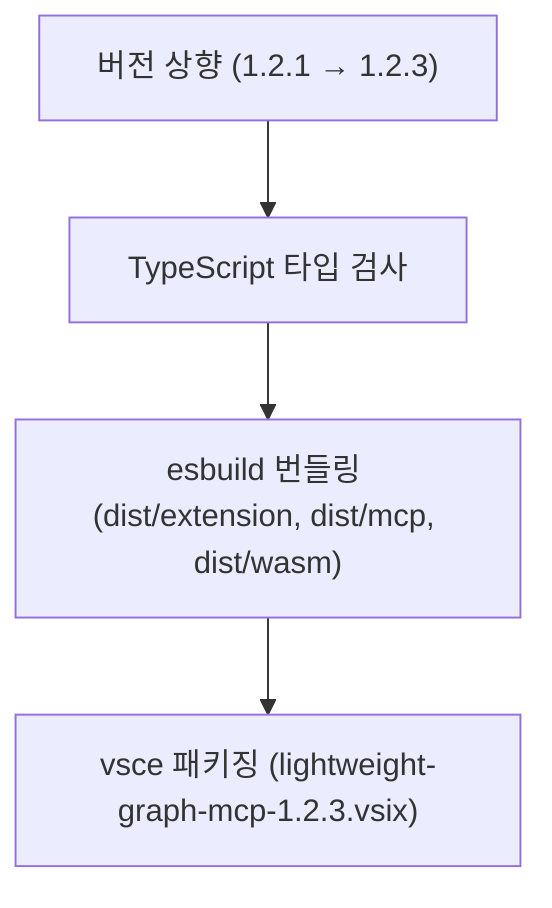

# 버전 1.2.3 업데이트 및 재빌드 보고서 (2026-11-03)

## 작업 원인 및 개요
- Cursor MCP 관리 메뉴 추가 및 Graphify 최신 반영 사항을 포함하여 확장 버전을 `1.2.1`에서 `1.2.3`으로 상향하고 최신 번들 및 VSIX 패키지를 생성함.

## 변경 내용
- `package.json`: `"version": "1.2.3"`으로 갱신
- `package-lock.json`: 패키지 버전 동기화
- `README.md`: 마켓플레이스 패키징 가이드 문서 내 vsix 파일명 버전(`lightweight-graph-mcp-1.2.3.vsix`) 동기화

## 빌드 및 패키징 흐름

## 빌드 결과
- 번들 빌드: `node esbuild.js --production` 정상 완료 (확장 진입점, stdio MCP 서버, WASM 에셋 복사 완료)
- VSIX 패키징: `D:\Projects\_Personal\lightweight-graph-vscode\lightweight-graph-mcp-1.2.3.vsix` 생성 완료 (총 57개 파일, 8.01 MB)

