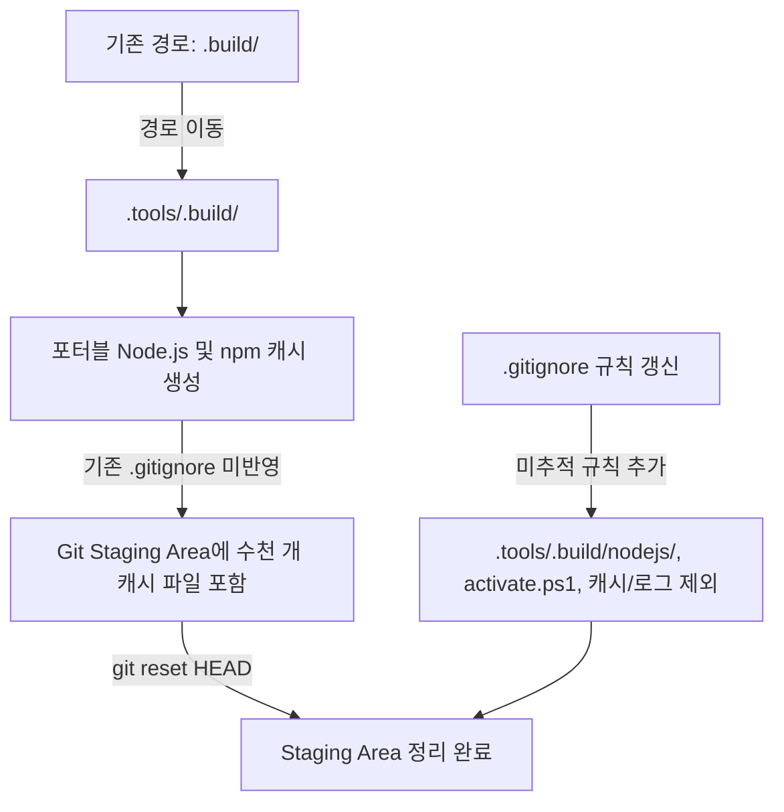

# .gitignore 업데이트 및 빌드 아티팩트 제외 보고서

- **작업 일시**: 2026-10-29 20:29:30
- **작업 내용**: 불필요한 빌드 아티팩트, 포터블 런타임, 캐시 및 메타데이터 폴더 .gitignore 등록

## 1. 원인 분석 (Cause)

- 기존 `.build/` 디렉터리가 `.tools/.build/`로 이동되었으나, `.gitignore`에는 여전히 이전 경로(`.build/*`)만 등록되어 있었습니다.
- 이로 인해 `.tools/.build/nodejs/` 내부의 포터블 Node.js 실행 바이너리 및 npm 캐시(`_cacache`) 파일 수천 개와 `activate.ps1`이 git staging 영역에 포함되어 있었습니다.
- 또한 로그(`*.log`), 테스트 커버리지/캐시(`coverage/`, `.cache/`, `.eslintcache`), OS 메타데이터(`Thumbs.db` 등), 환경변수 파일(`.env*`)에 대한 제외 규칙이 누락되어 있었습니다.

## 2. 조치 내역 (Fix)

1. **`.gitignore` 규칙 추가 및 갱신**
   - **도구 빌드 및 포터블 환경**:
     - `.tools/.build/*` (스크립트 `*.ps1`, `*.sh`, `*.md`, `*.cmd`는 화이트리스트 유지)
     - `.tools/.build/activate.ps1`, `.tools/.build/nodejs/`, `.tools/.build/_state/` 명시적 제외
   - **로그 및 디버그 산출물**: `*.log`, `npm-debug.log*`, `yarn-debug.log*`, `yarn-error.log*`
   - **테스트 커버리지 및 캐시**: `coverage/`, `.nyc_output/`, `.cache/`, `.eslintcache`
   - **환경 변수**: `.env`, `.env.*` (`!.env.example` 예외 유지)
   - **OS / 에디터 메타데이터**: `Thumbs.db`, `Desktop.ini`, `.idea/`, `*.swp`, `*.swo`
   - **Graphify**: `.tools/.graphify/` 외 추가 폴더인 `graphify/` 제외 등록

2. **Git Staging 영역 정리**
   - 디스크의 원본 파일 삭제 없이, 이미 staged 상태였던 `.tools/.build/nodejs/` 및 `.tools/.build/activate.ps1`을 `git reset HEAD`로 unstaged 처리하여 `.gitignore` 규칙이 즉각 적용되도록 조치.

