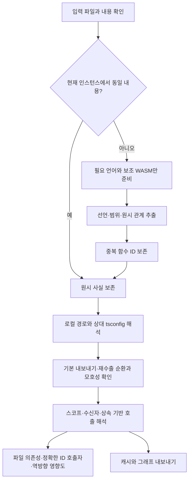
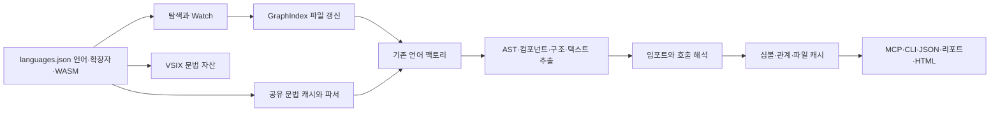

# Graphify 대비 언어·확장자 지원 확장

- 작업일: 2026-10-29, 한국 표준시
- 제품 버전: 1.2.0
- 비교 기준: 로컬 Graphify 0.9.97, `graphify.detect.CODE_EXTENSIONS` 114개
- 공개 기준: [Graphify 언어 목록](https://graphify.com/languages), [Graphify v8 소스](https://github.com/Graphify-Labs/graphify/tree/v8)

## 추가 감사: 언어·로직 동등성과 최적화

2026-10-29 후속 요청에 따라 같은 보고서를 갱신했다. 아래 결과가 이 보고서의 이전 검증·배포 기록보다 우선한다. 작업 시작 시 이미 있던 미커밋 언어 확장, 빌드 폴더 이동과 다른 사용자 변경은 보존했다.

**판정: 코드 파일 확장자는 모두 판별하지만, Graphify의 전체 분석 로직과 동등하지 않다. 검증한 반례에서 더 정확한 결과를 얻었으며, 전체 언어·임의 프로젝트의 우수성을 뜻하지 않는다.**

| 비교 항목 | 확인 결과 |
| --- | --- |
| 설치된 비교 기준 | Graphify 0.9.97. 원본 설치와 패키지는 변경하지 않음 |
| 코드 탐지 | `CODE_EXTENSIONS` 114개와 실제 `_DISPATCH` 키 117개 모두 현재 설정에서 판별 가능 |
| 현재 등록 | 54개 언어·형식 전략, 135개 확장자. 서로 다른 프로그래밍 언어 수와 동일한 지표가 아님 |
| 기본 추출 | 선언·호출·임포트·상속·타입 참조와 수신자 해석을 제공하나 언어별 범위가 다름 |
| 언어별 고급 해석 | Graphify의 26개 등록 해석기와 일대일 동등성이 없음. Ruby/PHP/Swift 수신자, Erlang 원격 호출, Elixir·Kotlin 정규화 경로, Pascal 상속, Terraform 모듈 출력 등의 고급 규칙은 추가 검증·구현 필요 |
| 인터페이스 디스패치 | Graphify의 C# 인터페이스·Swift 프로토콜 구현 연결과 동등하지 않음 |
| 문서와 데이터 | 제목·키·명시적 파일 참조 등 구조 추출. Markdown 코드 언급→심볼 연결, MCP/패키지 매니페스트 의미 해석과 동일하지 않음 |
| 그래프 통계 | 커뮤니티는 현재 가중치 기반 라벨 전파를 사용. Graphify의 군집화·중심성·의외 연결 계산과 동일한 값이 아님 |
| 멀티모달·외부 데이터 | PDF/Office/이미지 의미 분석, 전사, LLM 관계 생성, 실시간 PostgreSQL 분석은 미구현 |

공개 언어 페이지도 프로그래밍 언어 분석과 모델을 사용하는 문서·멀티모달 연결을 구분한다. 따라서 확장자 일치로 전체 Graphify 기능 지원을 주장하지 않는다. 비교는 로컬 고정 버전에 한정하며 공개 최신 버전과의 완전 일치를 주장하지 않는다.

### 확인한 원인과 수정

| 원인 | 수정 |
| --- | --- |
| 파일 의존성 API가 먼저 심볼을 찾고 파일 경로 요청을 거절 | 색인된 파일을 직접 인정하고 파일 내부 심볼 관계도 조회 |
| 정확한 심볼 ID 조회에도 `unknown::이름` 호출을 합침 | 정확한 ID 조회와 짧은 이름 조회를 구분해 잘못된 확정 호출자 차단 |
| JS의 함수 표현식·제너레이터가 선언·스코프 규칙에서 빠짐 | 함수 심볼·호출자 범위를 함께 추출. 변수 심볼 중복 생성 차단 |
| Java/C#/Apex의 동명 선언을 같은 ID로 저장 | 중복 함수만 선언 위치를 붙여 보존하고 본문·중첩 스코프 관계를 해당 선언에 귀속. 인자·타입에 따른 오버로드 선택은 하지 않음 |
| Python 클래스 함수는 `function`으로 저장되는데 영향도는 `method`만 인정 | 클래스 소유권으로 판단하고 중첩 클래스·중간 구현이 없는 상속·순환 방지까지 처리 |
| 영향도 탐색에서 방문 노드마다 전체 관계와 큐 앞부분을 재탐색 | 역방향 관계와 상속 인접 목록을 한 번 만들고 인덱스로 큐 순회 |
| 기본 import와 재수출 별칭의 실제 선언 정보 누락 | 선택적 `exportNames`·`reexports`를 저장·검증하고 기본/로컬 export 별칭·이름/별표 재수출 연결. 순환·모호성과 별표의 default 제외 검사 |
| tsconfig의 상대 상속과 원래 경로 기준을 읽지 않음 | 부모 설정·baseUrl·paths를 읽고 상속 순환 차단. TS 별칭을 다른 언어에 적용하지 않음 |
| 동적 require 인수를 문자열 경로로 오인 | 문자열 AST만 정적 의존성으로 채택 |
| Terraform data 이름을 두 부분으로 자르고 locals 선언을 누락 | data 세 부분 이름과 `local.이름` 선언·참조 보존 |
| Markdown 인라인 코드와 `git+ssh:` URI를 로컬 의존성으로 오인 | 코드 구간과 URI 스킴·네트워크 경로 제외 |
| 매번 모든 44개 WASM 문법 로드 | 입력 언어·필요 보조 문법만 준비. 기본 전체 초기화 API는 유지 |
| 새 파일과 변하지 않은 파일도 기존 전체 그래프에서 제거 후 복원 | 새 스냅샷의 첫 파일 삽입과 같은 인스턴스의 내용 불변 파일은 전체 제거 순회 생략. 디스크 캐시 신선도는 추정하지 않음 |
| 파일 확장자 판별마다 전체 언어 설정 순회 | 모듈 초기화 시 확장자→언어 Map 생성 |
| 폴더 이동 뒤 CLI·설정 도구가 예전 `.build` 경로를 사용 | `graph-mcp.cmd`와 설정 스크립트의 Node·설치·번들 경로를 `.tools/.build`로 연결 |
| 큰 입력 벤치마크도 불필요한 외부 NativeSound 폴더를 먼저 읽음 | `--large-only`·`--python-only`는 외부 프로젝트 없이 실행 |
| 위치 정보가 없는 esbuild 오류 출력에서 추가 TypeError 발생 | 위치가 있을 때만 파일·행·열을 출력해 원래 빌드 실패 원인 보존 |

새 선택적 메타데이터는 이전 캐시를 읽을 수 있게 유지했다. 배포와 조회의 기존 API 형태를 유지하며 전체 재생성 후 새 추출 결과가 반영된다. 실제 전체 CLI/HTML 시간을 포함한 성능으로 확대 해석하지 않는다.

### 추가 검증

- 실패 반례부터 확인한 `.test/audit-20261029.cjs`를 정상 동작 기대 검사로 전환했다. 이미 수정돼 있던 선언 없는 모듈 사례는 새 버그로 계산하지 않았다.
- 10개 프로젝트 반례, Terraform data/locals, Markdown 코드·원격 URI, 동적 require, 같은 줄의 C# 오버로드와 각 본문 호출, JS 문법만 있는 격리 자산의 색인이 통과했다.
- 기본·재수출·별표 네임스페이스와 모호성 반례를 추가한 정확도 비교 34개가 통과했다. `.test/accuracy-EDQNMh/result.json`에서 이 프로젝트는 기대 호출 23/23·오연결 0, Graphify는 16/23·오연결 7이다. 감시 대상으로 정한 호출자들의 결과이며, 전체 관계 정밀도 표본이 아니다.
- 기존 13개 언어의 원시 결과와 위치 기준본을 유지했다. 사용자 정의 전략 fixture는 실제 인터페이스에 맞는 이름·종류·범위를 채웠다.
- 44개 형식·대소문자·DMI 경계·반복 초기화·Watch 통합 검사, 생성·캐시 보존·잠금·UI 검사, TypeScript와 ESLint, Jest 14개를 최종 재검증했다. HTML 이스케이프와 잘못된 전역 설정 보존도 통과했다. 전역 설정은 변경하지 않았다.
- 실제 소스 차이 비교 `.test/review-412kHd/project-result.json`에서는 정규화한 의미 관계가 공통 306개, Graphify에만 37개, 이 프로젝트에만 146개다. 예를 들어 추상 메서드 호출의 연결 차이가 남는다. 차집합을 사람의 정답 없이 오류·정확도 점수로 취급하지 않는다.
- `.test/optimization-3b1Jrb/result.json`의 증분 변경·제거·복구·캐시 재로드·이전 캐시 복원·스코프·질의 상한·Python 상대 경로·Graphify 후보 선택 규칙 대조가 통과했다. 이 검사의 시각 측정은 아래 독립 벤치마크 수치에 합산하지 않았다.

### 최종 시간 비교

`.test/performance-0Qpbim/result.json`과 `audit.json`을 보존했다. Intel N100·Node v24.22.1·Windows 환경에서 혼합 TS/JS/Python 300파일과 Python 300파일을 각각 5개 독립 블록으로 실행했다. 블록마다 엔진 순서를 바꾸며 Graphify 순차·실제 4워커를 모두 비교했다. 측정 중 다른 검사는 겹치지 않았다.

단위는 ms이며 5블록 중앙값이다. Graphify 열은 해당 구간에서 중앙값이 더 낮은 설정이다. 첫 실행·재시작은 프로세스 시작을 포함하고, 반복 실행은 블록별 3회 중앙값, 변경은 한 파일 변경 뒤 전체 대상 갱신이다.

| 입력 | 구간 | 이 프로젝트 | Graphify | 중앙값 비율 |
| --- | --- | ---: | ---: | ---: |
| 혼합 300파일 | 첫 실행 | 1,509.7 | 6,945.3 | 4.60배 |
| 혼합 300파일 | 반복 | 154.7 | 3,457.8 | 22.36배 |
| 혼합 300파일 | 한 파일 변경 | 171.2 | 3,550.4 | 20.74배 |
| 혼합 300파일 | 프로세스 재시작 | 1,337.0 | 5,262.9 | 3.94배 |
| Python 300파일 | 첫 실행 | 1,197.2 | 11,266.2 | 9.41배 |
| Python 300파일 | 반복 | 188.8 | 4,429.7 | 23.46배 |
| Python 300파일 | 한 파일 변경 | 188.3 | 4,270.0 | 22.68배 |
| Python 300파일 | 프로세스 재시작 | 1,092.0 | 6,277.6 | 5.75배 |

모든 구간·블록에서 둘 중 더 빠른 Graphify 설정과 비교해도 이 프로젝트가 10% 이상 빨랐다. 양쪽 모두 두 입력의 기대 호출 1,200개를 재현하고 허용 목록 밖 호출은 0개였다. Python에서 Graphify의 디스크 캐시 적중과 실제 병렬 실행 기록도 확인했다.

`performance-audit.cjs --verify-current`로 총 30개 실행 묶음의 입력 해시, 처리 파일 수, 변경 심볼 반영, 재시작 노드·관계 일관성, 호출 정답·오연결을 검증했다. 최종 소스를 다시 컴파일한 36개 런타임 파일이 측정에 쓴 파일과 일치했다. `performance-newline.cjs`도 변경 후 Node/Python 입력 바이트 일치를 확인했다.

이는 AST·관계 해석·내부 JSON 저장의 합성 입력 측정이다. Graphify의 전체 고급 분석·군집화·HTML·LLM 기능을 동일하게 수행한 비교가 아니며, 모든 실제 프로젝트의 성능 우세·메모리 우세를 증명하지 않는다. 초기화와 반복 파일 교체를 줄인 효과는 포함하지만 작업 전 소스와 직접 비교한 최적화 비율은 측정하지 않았다.

### 최종 번들·패키지·CLI

- 검토용 산출물은 `lightweight-graph-mcp-1.2.0-reviewed.vsix`다. 기존 1.1.0·1.2.0 VSIX는 보존했다. 새 파일은 8,410,054바이트, 문법 44개를 포함한다.
- esbuild는 샌드박스의 상위 폴더 읽기 제한 때문에 실패했으나 승인된 프로젝트 빌드 실행으로 완료했다. 일반 패키징은 이전 임시 폴더 `.test/package-languages-6tstq68l`의 접근 권한 때문에 실패했다. 해당 폴더·권한을 변경하지 않고 `.test/package-review.cjs`로 배포 파일만 새 위치에 복사해 패키징했다. 원본 manifest·확장/MCP 번들의 바이트 일치를 검사했으며, 사전 빌드한 번들을 설치된 vsce로 압축했다.
- 격리 패키지 `.test/package-languages-e4zt9efc/extension/`의 44개 문법·런타임·개발 소스 제외를 검증했다. 실제 stdio MCP 13개 도구·다중 프로젝트·저장 캐시를 거친 기본/재수출 호출·44개 형식·CLI·잠금 오류도 통과했다.
- 이동한 포터블 Node 경로로 `config-graph-mcp.ps1 -Action Paths`와 `graph-mcp.cmd status/build/overview`가 동작했다. 현재 프로젝트 색인은 파일 46개·심볼 616개·관계 820개, 구문 경고 0개·커뮤니티 15개다. 산출물은 `.tools/.graphify/`에만 기록했다.
- 설치·게시·커밋·푸시는 수행하지 않았다. 설치 시 창을 다시 로드하고 MCP 재시작과 전체 색인 재생성이 필요하다. `git diff --check`도 통과했다.

### 남은 범위

패키지 이름·배열 tsconfig 상속, 임의 default 실행식, CommonJS 반출과 완전한 모듈 가시성, 인자·타입을 이용한 오버로드 선택, 언어별 고급 디스패치, 모든 SQL 방언·네이티브 확장 문법, 모든 Graphify 관계 종류는 완전 지원하지 않는다. 기존 부분 구조 분석 언어의 문법 한계도 유지된다. 새 의존성·범용 플러그인 계층·컴파일러 프레임워크는 추가하지 않았다.

## 원인

기존 설정과 팩토리에 13개 언어·32개 확장자만 등록되어 있었다. 탐색·Watch·파서·번들이 이 목록을 사용하므로 다른 언어 파일은 분석 전에 제외됐다. 문법 자산만 추가해서는 언어마다 다른 선언 이름·본문 범위·호출·임포트를 추출할 수 없었다.

추가 형식을 검증하면서 두 가지 공통 문제도 확인했다. 심볼이 없는 설정·프로젝트 파일은 캐시와 파일 노드에서 사라졌으며, 문법을 색인마다 다시 로드하면 반복 생성 중 WASM 함수 테이블이 고갈됐다.

## 수정

| 항목 | 결과 |
| --- | --- |
| 언어·파일 형식 전략 | 13개 → 54개. 서로 다른 자연어/프로그래밍 언어 수와 동일한 집계가 아님 |
| 확장자 | 32개 → 135개. `.C`·`.H` 특례 및 대소문자 정규화 적용 |
| Tree-sitter 문법 | 44개 고유 WASM. 방언의 공유 문법은 중복 로드하지 않음 |
| Graphify 확장자 | 기준 목록 114개 모두 판별. 대소문자만 다른 항목도 검사 |
| 기존 전략 | 기존 13개 원시 사실 보존 |
| 설정·문서 | JSON/YAML 키, Terraform 블록·참조, SQL 선언·참조, 프로젝트 의존성, Markdown 제목·로컬 링크 |
| 컴포넌트 | Vue·Svelte·Astro·EJS 외곽 AST에서 코드 영역을 선택하고 JS/TS AST 분석. 원본 줄·열 보존 |
| 구조 분석 | VB.NET·COBOL·Robot·DreamMaker, 솔루션·Delphi 폼·TOC. DMI는 PNG 상태 메타데이터 |
| 조회 | MCP와 CLI 상태에 `supportedExtensions` 추가 |
| 파일 보존 | 선택적 캐시 필드 `files`로 선언 없는 파일도 저장·참조·내보내기 |
| 반복 생성 | 문법 로드 Promise를 경로별로 공유하고 파서 인스턴스만 정리 |

기존 분석 인터페이스와 팩토리를 유지하고 추가 AST·구조·컴포넌트·텍스트 규칙을 네 파일에 모았다. 기존 호출 해석기에 언어별 대소문자 규칙과 Robot 키워드 정규화를 연결했다. 경로의 대소문자는 심볼 이름 정규화와 분리한다.

주석·문자열의 가짜 선언, 변수로 지정한 동적 임포트, PowerShell 매니페스트의 버전 문자열을 정적 의존성으로 오인하지 않도록 검사한다. DMI는 PNG 청크 범위를 검증하고 압축 해제에 8 MiB 상한을 적용한다. 생성된 의존성 잠금 파일은 그래프 잡음을 줄이기 위해 제외한다.

## 변경 범위와 호환성

- `src/common/languages.json`, 파서, 분석기 등록표, `src/core/language/`의 추가 전략.
- 파일 추적을 위한 내부 타입·캐시 검증·색인·임포트 해석·내보내기·프로젝트 개요.
- 관계 해석의 언어별 이름 정규화, JS/TS 계열의 신규 확장자 후보.
- 패키지/잠금 파일, WASM 복사, 상태 조회, README, 저장소 내 스킬 설명.
- `.test/`의 신규 통합 검사·입력·비교 기준과 기존 검사 조정. 기존 기준본의 PC 절대 경로만 정규화.
- Jest는 새 Tree-sitter 런타임의 동적 import를 허용하고 생성된 패키지 디렉터리를 모듈 색인에서 제외.
- `.gitignore`는 새 검사 원본만 추가 허용. 기존 사용자 수정과 빌드 디렉터리 이동을 유지.

캐시의 새 필드는 선택 사항이므로 이전 캐시도 읽을 수 있다. 새 언어와 추출 규칙을 반영하려면 그래프 전체 재생성과 MCP 재시작이 필요하다. 커밋·푸시·확장 설치·외부 게시는 수행하지 않는다.

## 검증

| 검사 | 결과 |
| --- | --- |
| TypeScript 컴파일 | 통과 |
| ESLint | 통과 |
| Jest | 3개 묶음, 14개 검사 통과 |
| 기존 언어 기준본 | 13개 언어 원시 심볼·관계·위치 동일 |
| 신규 지원 통합 검사 | 44개 입력, Graphify 확장자 114개 판별, 대소문자·오인식·동적 임포트·매니페스트·원본 위치·DMI·선언 없는 파일·Watch 통과 |
| 문법 수명 | 초기화·파싱·정리 40회 통과 |
| 기존 생성·캐시·UI 검사 | 통과 |
| 기존 정확도 비교 | 26개 반례 통과, 결과 `.test/accuracy-aiNr8K/result.json` |
| 최적화 회귀 검사 | 통과. 이 실행의 시각 측정값은 언어 확대 성능 비교로 사용하지 않음 |

재현 명령은 README 7절에 기록했다. 검사 출력과 생성 파일은 `.test/` 아래에 두고 그래프·캐시는 해당 입력 루트의 `.tools/.graphify/`에만 저장한다.

## 실제 Graphify와 동일 입력 비교

`.test/compare-language-support.py`가 설치된 Graphify의 실제 형식별 추출기를 실행한다. `.test/compare-language-support.cjs`는 사람이 명시한 기대 심볼과 호출을 현재 분석 결과와 비교한다. 결과는 `.test/language-comparison/.tools/.graphify/`에 저장하며 추출기 소스 SHA-256도 기록한다.

| 양쪽 추출기가 실행된 33개 기본 입력 | 이 프로젝트 | Graphify 0.9.97 |
| --- | --- | --- |
| 기대 심볼 69개 | 69개 | 55개 |
| 기대 호출 23개 | 23개 | 20개 |

전체 입력 44개 중 Graphify의 선택 의존성 미설치로 실행되지 않은 11개는 위 집계에서 제외했다. R·OCaml·OCaml 인터페이스·Common Lisp·Erlang·Solidity·Terraform·SQL·VB.NET·DreamMaker·Robot이 해당한다. 이 프로젝트의 해당 입력은 자체 검사로 검증했다. 기존 Graphify 환경의 패키지를 변경하지 않았다.

이 표는 기본 구문 입력에서의 기대 항목 재현 결과다. 모든 관계의 정밀도·모든 언어의 전체 기능·임의 프로젝트의 우수성을 증명하지 않는다. Graphify 전체 코퍼스의 파일 간 해석·커뮤니티 결과와 동일하다는 주장도 아니다.

## 한계

- VB.NET·COBOL·Robot·DreamMaker는 부분 구조 분석이며 전체 문법을 검증하지 않는다. 해당 파일을 부분 지원으로 보고한다.
- CUDA/Metal·Objective-C++·Luau·Apex, SQL 방언과 일부 Kotlin 유효 구문에는 문법 한계가 남는다.
- XML은 HTML AST를 활용한 프로젝트 의존성 구조 추출이며 스키마 검증을 제공하지 않는다. 바이너리 Delphi 폼은 처리하지 않는다.
- 컴포넌트 템플릿 식·이벤트, 복잡한 타입·동적 디스패치·재수출·언어별 고급 모듈 규칙은 완전한 컴파일러 분석이 아니다.
- PDF·Office·이미지의 의미 분석과 오디오/동영상 전사는 구현하지 않았다. 일반 텍스트도 제목·링크 구조만 제공한다.
- 원시 문법 자산은 약 100 MB다. 모든 입력 규모에 대한 메모리·시간 비교나 실제 VS Code GUI 설치 검사는 별도 수행하지 않았다.

## 배포 확인

- 설치 파일: 프로젝트 루트 `lightweight-graph-mcp-1.2.0.vsix`, 8,406,661바이트, 약 8.02 MiB.
- `.test/vsix-language-support.py`로 44개 문법과 두 번들의 런타임 포함을 확인했다. 소스·node_modules·테스트·작업 보고서·개발용 core 출력은 패키지에서 제외했다.
- 격리 위치: `.test/package-languages-6tstq68l/extension/`. 실제 MCP stdio 서버로 기존 13개 도구·다중 프로젝트·CLI·잠금 오류 및 새 형식 44개 입력의 생성·캐시 심볼·확장자 공개가 모두 통과했다.
- 격리된 CLI로 현재 프로젝트도 생성했다. 파일 46개·심볼 607개·관계 796개, 구문 경고 0개였으며 `.tools/.graphify/`에 결과를 갱신했다.
- 최종 TypeScript 컴파일·ESLint·Jest 14개·신규 지원 통합 검사·`git diff --check`가 통과했다. 설치와 게시 없이 검토 가능한 VSIX를 남겼다.

설치 후 VS Code 창을 다시 로드하고 **Graph MCP: Rebuild Index**를 실행한다. 실행 중인 MCP도 재시작한다. 1.1.0 VSIX와 작업 전 사용자 변경은 보존했다.
