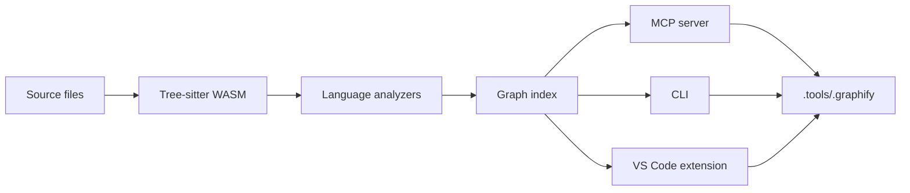

# Lightweight Graph MCP

[](https://code.visualstudio.com/)
[](LICENSE)

다국어 코드 그래프를 로컬에서 생성하고 MCP, CLI, VS Code 확장으로 탐색합니다.

(Build multilingual code graphs locally and explore them through MCP, the CLI, or the VS Code extension.)

Lightweight Graph MCP는 포함된 Tree-sitter WASM 문법을 사용해 소스 코드를 분석합니다. Python, Graphify CLI, Docker, API 키, 원격 분석 서비스는 필요하지 않습니다.

(Lightweight Graph MCP parses source code with bundled Tree-sitter WASM grammars. It works without Python, Graphify CLI, Docker, API keys, or remote analysis services.)

## Contents

- [Features](#features)
- [Architecture](#architecture)
- [Quick Start](#quick-start)
- [Supported Languages](#supported-languages)
- [MCP Tools](#mcp-tools)
- [Graph Outputs](#graph-outputs)
- [Analysis Scope](#analysis-scope)
- [Development](#development)
- [License](#license)

## Features

- 로컬 Tree-sitter WASM을 사용해 코드를 분석하며 소스 코드를 외부 서비스로 보내지 않습니다.

  (Parse code with local Tree-sitter WASM grammars without sending source code to an external service.)
- VS Code 확장, MCP 서버, 명령줄 인터페이스를 함께 제공합니다.

  (Use the VS Code extension, MCP server, and command-line interface together.)
- 파일 변경을 감시하고 그래프를 갱신할 수 있습니다.

  (Watch for file changes and update the graph.)
- 프로젝트별 그래프와 분석 리포트를 `.tools/.graphify/`에 저장합니다.

  (Store each project's graph and analysis report in `.tools/.graphify/`.)
- `project_path` 인수로 하나의 전역 MCP 서버에서 여러 프로젝트를 조회할 수 있습니다.

  (Query multiple projects through one global MCP server by passing `project_path`.)

## Architecture



## Quick Start

### Requirements

VS Code 1.102 or newer is required for the extension. Install Node.js and npm to build the VSIX package from source.

### Install the VS Code extension

1. 프로젝트 루트에서 VSIX를 빌드합니다.

   (Build the VSIX package from the project root.)

   ```powershell
   npm install
   npm run package
   ```

2. VS Code의 Extensions 보기에서 **Install from VSIX…**를 선택하고 생성된 `.vsix` 파일을 지정합니다.

   (In the VS Code Extensions view, select **Install from VSIX…** and choose the generated `.vsix` file.)

3. VS Code를 다시 로드하고 색인할 프로젝트 폴더를 엽니다.

   (Reload VS Code and open the project folder you want to index.)

4. 상태 표시줄의 **Graph** 메뉴에서 **Build Graph**를 선택합니다. 변경을 자동 반영하려면 **Start Watch**를 선택합니다.

   (Choose **Build Graph** from the **Graph** status-bar menu. Choose **Start Watch** to apply changes automatically.)

### Configure an MCP client

전역 MCP 서버와 에이전트 스킬을 등록하려면 프로젝트 루트에서 다음 명령을 실행합니다.

(Run the following command from the project root to register the global MCP server and agent skill.)

```powershell
.\config-graph-mcp.cmd
.\config-graph-mcp.cmd -Action Status
```

설정 도구는 Antigravity, Codex, Claude, Cursor, VS Code에서 사용할 수 있는 연결을 구성합니다. Antigravity와 Codex의 설정 위치는 각각 `~/.gemini/config/mcp_config.json`, `~/.codex/config.toml`입니다.

(The setup tool configures connections for Antigravity, Codex, Claude, Cursor, and VS Code. The Antigravity and Codex configuration files are `~/.gemini/config/mcp_config.json` and `~/.codex/config.toml`, respectively.)

### Connect llama.vscode

1. 상태 표시줄의 **Graph** 메뉴에서 **Start/Stop MCP Server**를 선택합니다.

   (Choose **Start/Stop MCP Server** from the **Graph** status-bar menu.)
2. VS Code 서버 목록에서 **Lightweight Graph MCP**를 시작합니다.

   (Start **Lightweight Graph MCP** in the VS Code server list.)
3. **Graph → Open Llama Agent** 또는 `Ctrl+Shift+A`로 에이전트를 엽니다.

   (Open the agent with **Graph → Open Llama Agent** or `Ctrl+Shift+A`.)
4. **Select Tools**에서 Graph MCP 도구를 선택하고 **OK**를 누릅니다.

   (Select the Graph MCP tools in **Select Tools**, then choose **OK**.)

### Use the CLI

`graph-mcp.cmd`는 색인 생성, 감시, 검색과 그래프 탐색 명령을 제공합니다.

(`graph-mcp.cmd` provides commands for indexing, watching, searching, and graph traversal.)

```powershell
.\graph-mcp.cmd build "<project-path>"
.\graph-mcp.cmd watch "<project-path>" [debounce-seconds]
.\graph-mcp.cmd overview "<project-path>"
.\graph-mcp.cmd query "<query>" "<project-path>"
.\graph-mcp.cmd path "<source-symbol>" "<target-symbol>" "<project-path>"
.\graph-mcp.cmd god-nodes "<project-path>"
.\graph-mcp.cmd communities "<project-path>"
.\graph-mcp.cmd report "<project-path>"
```

### Example prompt

The following prompt works with any connected MCP client:

> Check the index with `get_index_status`. If the index is missing or stale, run `build_index`, then use `query_graph`, `shortest_path`, and `get_god_nodes` to explore the relevant code.

## Supported Languages

버전 1.2.0은 54개 언어·파일 형식 분석 전략, 44개 고유 WASM 문법, 135개 확장자를 등록합니다. JSX는 JavaScript, Gradle은 Groovy, Luau는 Lua, SystemVerilog는 Verilog 분석 전략을 공유하므로 언어 수에 중복으로 포함하지 않습니다.

(Version 1.2.0 registers 54 language and file-format strategies, 44 unique WASM grammars, and 135 extensions. JSX shares the JavaScript analyzer, Gradle shares Groovy, Luau shares Lua, and SystemVerilog shares Verilog; these are not counted twice.)

Graphify 0.9.97의 코드 확장자 114개도 모두 판별합니다. 이는 확장자 인식 범위의 비교이며, 분석 로직이나 결과가 Graphify와 완전히 같다는 뜻은 아닙니다.

(The extension also recognizes all 114 code extensions from Graphify 0.9.97. This compares extension detection only; it does not claim full parity in analysis logic or results.)

| Language / Format | Common extensions | Analysis coverage |
| --- | --- | --- |
| JavaScript | `js`, `jsx`, `mjs`, `cjs` | 선언, 호출, 임포트, 상속<br>(Declarations, calls, imports, and inheritance)|
| TypeScript / TSX | `ts`, `mts`, `cts`, `tsx` | 선언, 호출, 임포트, 상속, 구현; TSX 전용 문법<br>(Declarations, calls, imports, inheritance, implementations, and TSX syntax)|
| Python | `py`, `pyi`, `pyw` | 클래스, 함수, 호출, 임포트, 부모 클래스<br>(Classes, functions, calls, imports, and base classes)|
| Java | `java` | 클래스, 인터페이스, 메서드, 호출, 임포트, 상속, 구현<br>(Classes, interfaces, methods, calls, imports, inheritance, and implementations)|
| Go | `go` | 타입, 함수, 메서드, 호출, 임포트, 메서드 receiver 범위<br>(Types, functions, methods, calls, imports, and method receiver scope)|
| Rust | `rs` | 구조체, 열거형, 트레이트, 함수, impl 범위, 호출, use 임포트<br>(Structs, enums, traits, functions, impl scopes, calls, and use imports)|
| C | `c`, `h` | 구조체, 타입, 함수 선언과 정의, 호출, include<br>(Structs, types, function declarations and definitions, calls, and includes)|
| C++ | `cc`, `cpp`, `cxx`, `hh`, `hpp`, `hxx` 등 | 네임스페이스, 클래스, 함수, 호출, include, 상속<br>(Namespaces, classes, functions, calls, includes, and inheritance)|
| C# | `cs` | 네임스페이스, 클래스, 인터페이스, 메서드, 호출, using, 상속<br>(Namespaces, classes, interfaces, methods, calls, using directives, and inheritance)|
| Objective-C | `m` | 클래스, 메서드, C 함수 호출, include/import, 상속<br>(Classes, methods, C function calls, includes/imports, and inheritance)|
| Objective-C++ | `mm` | Objective-C와 C++ AST 병합을 사용하는 부분 지원<br>(Partial support using merged Objective-C and C++ ASTs)|
| CUDA / Metal | `cu`, `cuh`, `metal` | C++ 문법 기반 선언과 일반 호출의 부분 분석<br>(Partial declaration and general-call analysis using C++ grammar)|
| Ruby | `rb`, `rake`, `gemspec` | 클래스, 모듈, 메서드, 호출, require/load, 상속<br>(Classes, modules, methods, calls, require/load, and inheritance)|
| Kotlin / Scala | `kt`, `kts`, `scala`, `sc` | 클래스, 함수, 호출, 임포트, 상속; 일부 Kotlin 구문에서 경고 가능<br>(Classes, functions, calls, imports, and inheritance; some valid Kotlin syntax may produce warnings)|
| PHP / Swift | `php`, `phtml`, `php3`–`php5`, `swift` | 클래스, 함수, 메서드, 호출, 정적 의존성, 상속<br>(Classes, functions, methods, calls, static dependencies, and inheritance)|
| Lua / Luau | `lua`, `luau`, `toc` | 함수, 호출, require, TOC의 Lua/XML 파일 목록; Luau 전용 타입은 부분 지원<br>(Functions, calls, require, Lua/XML file lists from TOC; partial support for Luau-specific types)|
| Zig / Julia | `zig`, `jl` | 함수, 호출, 정적 임포트; Julia 모듈과 구조체<br>(Functions, calls, static imports, plus Julia modules and structs)|
| PowerShell | `ps1`, `psm1`, `psd1` | 함수, 클래스, 명령 호출, 모듈/매니페스트 의존성<br>(Functions, classes, command calls, and module/manifest dependencies)|
| Elixir / Erlang | `ex`, `exs`, `erl`, `hrl`, `escript` | 모듈, 함수, 호출, 정적 의존성<br>(Modules, functions, calls, and static dependencies)|
| Groovy / Gradle / Dart | `groovy`, `gradle`, `dart` | 클래스, 메서드, 호출, 임포트, 상속<br>(Classes, methods, calls, imports, and inheritance)|
| Fortran / Bash / R | `f`, `for`, `f90`, `f95`, `f03`, `f08`, `sh`, `bash`, `zsh`, `r` | 함수, 서브루틴, 호출, 정적 의존성<br>(Functions, subroutines, calls, and static dependencies)|
| OCaml / Common Lisp | `ml`, `mli`, `lisp`, `cl`, `lsp`, `asd` | 함수, 모듈, 선언, 호출, 임포트; mli 전용 문법<br>(Functions, modules, declarations, calls, imports, and mli-specific syntax)|
| Solidity / Apex | `sol`, `cls`, `trigger` | 클래스/컨트랙트, 함수, 호출, 상속; Apex는 Java 문법 기반 부분 지원<br>(Classes/contracts, functions, calls, and inheritance; Apex has partial support based on Java grammar)|
| Verilog / SystemVerilog | `v`, `vh`, `sv`, `svh` | 모듈, 인터페이스, 함수, 태스크, 인스턴스화, include<br>(Modules, interfaces, functions, tasks, instantiations, and includes)|
| Pascal / Delphi | `pas`, `pp`, `dpr`, `dpk`, `lpr`, `inc` | 함수, 프로시저, 호출, uses; 대소문자 비구분<br>(Functions, procedures, calls, and uses clauses; case-insensitive names)|
| Vue / Svelte / Astro / EJS | `vue`, `svelte`, `astro`, `ejs` | 외곽 AST에서 코드 영역을 골라 JS/TS 분석; 원본 위치 유지<br>(Extract code regions from outer ASTs for JS/TS analysis while preserving source locations)|
| JSON / YAML / Terraform | `json`, `yaml`, `yml`, `tf`, `tfvars`, `hcl` | 구조 키, 인프라 블록, 명시적 참조; 일반 설정값은 심볼로 노출하지 않음<br>(Structural keys, infrastructure blocks, and explicit references; ordinary config values are not exposed as symbols)|
| SQL | `sql` | 테이블, 뷰, 루틴 선언과 뷰의 테이블 참조; 방언별 구문은 부분 지원<br>(Table, view, and routine declarations plus table references in views; partial dialect-specific syntax support)|
| XML / .NET / Razor | `xml`, `slnx`, `csproj`, `fsproj`, `vbproj`, `xaml`, `lpk`, `razor`, `cshtml` | 프로젝트 의존성, Razor C# 메서드·호출·using; XML은 구조 분석<br>(Project dependencies and Razor C# methods/calls/using; XML receives structural analysis)|
| Solutions / Delphi forms | `sln`, `dfm`, `lfm` | 프로젝트, 구성요소, 이벤트 참조의 텍스트 구조 분석; 바이너리 Delphi 폼 미지원<br>(Structural text analysis of projects, components, and event references; binary Delphi forms are unsupported)|
| VB.NET / COBOL / Robot Framework | `vb`, `cbl`, `cob`, `cobol`, `cpy`, `robot`, `resource` | 블록, 문단, 키워드, 호출/의존성의 부분 구조 분석<br>(Partial structural analysis of blocks, paragraphs, keywords, calls, and dependencies)|
| DreamMaker / BYOND | `dm`, `dme`, `dmm`, `dmf`, `dmi` | 함수, 타입, include, 맵 타입 참조, UI 요소의 부분 분석; DMI는 PNG 상태 메타데이터만 추출<br>(Partial analysis of functions, types, includes, map type references, and UI elements; DMI extracts PNG state metadata only)|
| Markdown / text | `md`, `mdx`, `qmd`, `skill`, `txt`, `rst` | Markdown 제목과 로컬 링크; 일반 텍스트 의미 추론은 제공하지 않음<br>(Markdown headings and local links; semantic inference from plain text is not provided)|

## MCP Tools

13개 MCP 도구는 선택적 `project_path` 인수를 받아 여러 프로젝트를 조회할 수 있습니다.

(The 13 MCP tools accept an optional `project_path` argument so you can query multiple projects.)

| Tool | Description |
| --- | --- |
| `build_index` | 그래프, 리포트, HTML을 생성하거나 갱신합니다.<br>(Build or update the graph, report, and HTML view.)|
| `get_index_status` | 색인 상태, 심볼 수, 지원 언어와 산출물 경로를 반환합니다.<br>(Return index status, symbol count, supported languages, and output paths.)|
| `get_project_overview` | 파일, 심볼, 관계, 커뮤니티와 주요 심볼을 요약합니다.<br>(Summarize files, symbols, relations, communities, and central symbols.)|
| `query_graph` | 검색 결과를 시작점으로 BFS/DFS 서브그래프를 탐색합니다.<br>(Explore a BFS/DFS subgraph starting from search results.)|
| `shortest_path` | 두 심볼 또는 파일 사이의 최단 경로를 찾습니다.<br>(Find the shortest path between two symbols or files.)|
| `get_god_nodes` | 연결이 많은 핵심 추상화 심볼을 조회합니다.<br>(List highly connected, central abstraction symbols.)|
| `get_communities` | 모듈 커뮤니티, 응집도, 소속 노드를 조회합니다.<br>(Return module communities, cohesion, and member nodes.)|
| `search_symbols` | 이름 또는 ID 패턴으로 심볼을 검색하고 일치도순으로 정렬합니다.<br>(Search symbols by name or ID pattern, sorted by relevance.)|
| `get_symbol_info` | 심볼의 상세 정보를 반환합니다.<br>(Return detailed information about a symbol.)|
| `get_dependencies` | 심볼 또는 파일의 의존 관계를 반환합니다.<br>(Return dependencies for a symbol or file.)|
| `get_callers` | 대상 심볼을 호출하는 심볼을 찾습니다.<br>(Find symbols that call the target.)|
| `get_callees` | 대상 심볼이 호출하는 심볼을 찾습니다.<br>(Find symbols called by the target.)|
| `get_impact` | 수정 시 영향을 받을 호출·상속 관계를 깊이 제한과 함께 추적합니다.<br>(Trace affected call and inheritance relations with a configurable depth limit.)|

## Graph Outputs

모든 프로젝트 산출물은 `<project>/.tools/.graphify/` 아래에 저장합니다.

(All project outputs are stored under `<project>/.tools/.graphify/`.)

| Artifact | Description |
| --- | --- |
| `graph-cache.json` | MCP 조회에 쓰이는 내부 심볼·관계 캐시입니다.<br>(Internal symbol and relation cache used by MCP tools.)|
| `graph.json` | 파일과 심볼 노드, 관계 링크, 커뮤니티, 정규화 라벨, 신뢰도 가중치를 담은 그래프입니다.<br>(Graph containing file and symbol nodes, relation links, communities, normalized labels, and confidence weights.)|
| `GRAPH_REPORT.md` | 핵심 추상화, 순환 임포트, 커뮤니티, 모호한 관계, 지식 공백과 추천 질문을 한국어로 요약합니다.<br>(Korean report covering central abstractions, import cycles, communities, ambiguous relations, knowledge gaps, and suggested questions.)|
| `graph.html` | 검색, 커뮤니티 필터, 테마 전환과 소스 위치 탐색을 지원하는 오프라인 대화형 시각화입니다.<br>(Offline interactive visualization with search, community filters, theme switching, and source navigation.)|

이 그래프는 Graphify와 유사한 노드·링크 개념을 사용하지만 ID와 스키마 버전은 다릅니다. 커뮤니티는 자체 라벨 전파 방식으로 계산하며 Graphify의 Leiden 결과와 같지 않습니다. 신뢰도 값은 해석 규칙의 가중치이며 정확도의 확률값이 아닙니다.

(The graph uses node and link concepts similar to Graphify, but its IDs and schema version differ. Communities use this project's label-propagation method and do not match Graphify's Leiden results. Confidence values are rule weights, not probabilities of correctness.)

## Analysis Scope

분석기는 AST와 정적 구조를 기반으로 관계를 추출합니다. 컴파일러의 완전한 타입 검사, 모든 동적 디스패치, 재할당 흐름을 대체하지 않습니다.

(Analyzers extract relations from ASTs and static structure. They do not replace full compiler type checking, complete dynamic-dispatch analysis, or reassignment-flow analysis.)

JavaScript, TypeScript, Python에서는 범위와 확인 가능한 수신자 타입을 사용해 `this`/`self` 호출, 별칭 임포트, 재수출을 연결합니다. Java와 C#의 동명 오버로드는 각각 보존하지만 인자 타입만으로 호출 대상을 확정하지는 않습니다.

(For JavaScript, TypeScript, and Python, the analyzer uses scope and known receiver types to resolve `this`/`self` calls, aliased imports, and re-exports. Java and C# overloads with the same name remain distinct, but argument types alone do not determine the call target.)

Objective-C++, CUDA/Metal, Apex, VB.NET, COBOL, Robot Framework, DreamMaker, 일부 템플릿과 SQL 방언은 부분 지원입니다. 지원 범위는 위 표와 파일별 구문 경고를 기준으로 확인하세요.

(Objective-C++, CUDA/Metal, Apex, VB.NET, COBOL, Robot Framework, DreamMaker, some templates, and SQL dialects have partial support. See the table above and per-file syntax warnings for the supported scope.)

PDF·Office 문서·이미지의 의미 분석, 오디오/비디오 전사, LLM 기반 추론은 제공하지 않습니다. 패키지 잠금 파일은 그래프 잡음을 줄이기 위해 색인에서 제외합니다.

(Semantic analysis of PDF/Office documents or images, audio/video transcription, and LLM-based inference are not provided. Package lock files are excluded to reduce graph noise.)

## Development

저장소를 빌드하려면 Node.js와 npm을 설치한 다음 의존성을 복원합니다.

(Install Node.js and npm, then restore dependencies to build the repository.)

```sh
npm install
npm run compile
npm run lint
npm test
npm run bundle
npm run package
```

`npm run package`는 VS Code가 설치할 수 있는 VSIX 파일을 생성합니다. 언어 분석을 추가할 때는 `src/common/languages.json`에 문법과 확장자를 등록하고, `src/core/language/`에 AST 규칙을 구현한 뒤 `.build/.test/`에 선언·호출·임포트 반례를 추가하세요.

(`npm run package` creates a VSIX file that VS Code can install. To add language analysis, register its grammar and extensions in `src/common/languages.json`, implement AST rules under `src/core/language/`, and add declaration, call, and import cases under `.build/.test/`.)

## Marketplace 게시

1. [Marketplace 게시자 관리](https://marketplace.visualstudio.com/manage)에서 Microsoft 계정으로 로그인하고 게시자를 만듭니다. 현재 `package.json`의 게시자 ID는 `lightweight`입니다. 다른 ID로 만들면 `publisher` 값을 변경한 후 패키지를 다시 생성하세요.
2. `npm run compile`과 `npm run lint`를 실행한 뒤 `npm run package`로 `lightweight-graph-mcp-1.2.1.vsix`를 생성합니다. 시스템 Node.js가 없다면 저장소의 `.tools\\.build\\npm.cmd`를 `npm` 대신 사용할 수 있습니다.
3. VS Code의 **Extensions: Install from VSIX…**로 설치하고 그래프 생성과 MCP 서버 연결을 확인합니다.
4. 게시자 관리 화면에서 **New extension → Visual Studio Code**를 선택하고 VSIX를 업로드합니다. 이후 업데이트는 버전을 올려 새 VSIX를 업로드합니다.

수동 업로드에는 CLI용 PAT가 필요하지 않습니다. 자세한 절차는 [VS Code 공식 게시 문서](https://code.visualstudio.com/api/working-with-extensions/publishing-extension)를 참고하세요. VS Code의 전역 연결 메뉴는 내장 런타임을 사용하므로 별도 Node.js가 필요하지 않습니다. Windows PowerShell을 통해 기존 MCP 항목을 현재 설치 경로로 갱신하고 원래 설정을 `.bak` 파일로 백업합니다. 확장을 업데이트하거나 설치 위치를 바꾼 뒤에는 전역 연결 메뉴를 다시 실행하고 연결된 클라이언트의 MCP 서버를 다시 시작하세요. 저장소에서 설정 명령을 직접 실행할 때는 Node.js가 필요합니다.

## License

MIT 라이선스입니다. Tree-sitter 문법과 의존성에는 각자의 라이선스가 적용됩니다.

(This project is licensed under MIT. Tree-sitter grammars and dependencies retain their respective licenses.)
