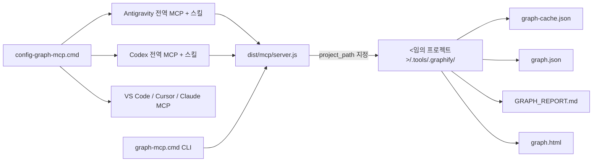
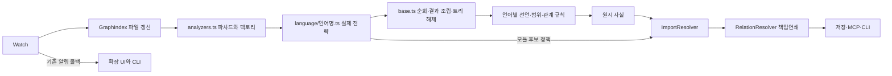

# Lightweight Graph MCP

프로젝트 소스에서 다국어 AST 기반 코드 그래프를 생성하고, **Antigravity · Codex · Claude · Cursor · VS Code (llama.vscode 등)** 에이전트가 MCP 및 CLI로 즉시 조회할 수 있는 경량 코드 그래프 확장·엔진입니다. 코드 파싱은 로컬 Tree-sitter WASM으로 수행하며 Python·Graphify CLI·Docker·외부 API가 필요하지 않습니다.

## 1. Antigravity · Codex 전역 연결 (언제든 바로 쓰기)

단 한 번의 명령으로 **Antigravity**(`~/.gemini/config/mcp_config.json`), **Codex**(`~/.codex/config.toml`), **Claude**, **Cursor**, **VS Code**의 전역 MCP 설정과 에이전트 스킬(`SKILL.md`)을 자동 등록할 수 있습니다.

```powershell
# 전역 MCP 서버 및 스킬 자동 설정
.\config-graph-mcp.cmd

# 등록 상태 확인
.\config-graph-mcp.cmd -Action Status
```

또는 VS Code 하단 상태표시줄의 **`Graph` 아이콘 클릭 → `Antigravity · Codex 전역 MCP/스킬 연결`**을 선택해도 동일하게 설정됩니다.

- 모든 MCP 도구(`build_index`, `query_graph`, `shortest_path`, `get_god_nodes`, `get_communities`, `search_symbols` 등)가 선택적 `project_path` 인수를 지원하므로, **전역 MCP 서버 하나만 등록해 두면 어떤 프로젝트 폴더든 즉시 색인·조회**할 수 있습니다.
- 터미널에서 직접 실행할 수 있는 `graph-mcp.cmd` CLI도 함께 제공합니다:
  ```powershell
  .\graph-mcp.cmd build "<프로젝트_경로>"
  .\graph-mcp.cmd watch "<프로젝트_경로>" [디바운스_초]
  .\graph-mcp.cmd overview "<프로젝트_경로>"
  .\graph-mcp.cmd query "<검색어_또는_질문>" "<프로젝트_경로>"
  .\graph-mcp.cmd path "<출발_심볼>" "<도착_심볼>" "<프로젝트_경로>"
  .\graph-mcp.cmd god-nodes "<프로젝트_경로>"
  .\graph-mcp.cmd communities "<프로젝트_경로>"
  .\graph-mcp.cmd report "<프로젝트_경로>"
  ```



## 2. VS Code 확장 설치와 그래프 생성

VS Code 1.102 이상이 필요합니다. `llama.vscode` 0.0.73은 자체적으로 VS Code 1.109 이상을 요구하므로 함께 사용할 때는 두 확장의 요구사항을 모두 만족해야 합니다.

1. 확장 보기의 `… → VSIX에서 설치`에서 빌드된 `lightweight-graph-mcp-1.2.0.vsix`를 설치합니다.
2. VS Code 창을 다시 로드하고 분석할 프로젝트 폴더를 엽니다.
3. **하단 상태표시줄의 `Graph: 그래프 생성`을 클릭**합니다.
4. **현재 프로젝트 그래프 생성·갱신**을 선택하거나, **실시간 감시(Watch) 시작**을 선택해 소스 파일 변경 시 자동으로 그래프를 갱신합니다.
5. 생성 완료 메시지에서 파일·심볼 수와 구문 경고를 확인합니다. 실시간 감시가 켜져 있으면 하단 상태표시줄 아이콘이 `$(eye) Graph: 감시 중`으로 표시되며, 같은 메뉴에서 언제든 중지할 수 있습니다.

## 3. llama.vscode 연결

1. **하단 Graph 클릭 → MCP 서버 시작·중지**를 선택합니다.
2. 표시되는 VS Code 서버 목록에서 **Lightweight Graph MCP → Start Server/서버 시작**을 선택합니다.
3. **하단 Graph 클릭 → Llama Agent 열기**, 또는 `Ctrl+Shift+A`를 사용합니다.
4. Llama Agent의 **Select Tools**에서 Graph 서버 도구를 선택하고 **OK**를 누릅니다.
5. 다음처럼 요청합니다:

> 먼저 get_index_status로 상태를 확인해 줘. 색인이 없거나 코드가 변경됐다면 build_index로 갱신한 뒤 query_graph, shortest_path, get_god_nodes로 관련 코드를 분석해 줘.

## 4. 지원 언어와 파일 형식

1.2.0은 **54개 언어·파일 형식 전략, 44개 고유 WASM 문법, 135개 확장자**를 등록한다. JSX는 JavaScript, Gradle은 Groovy, Luau는 Lua, SystemVerilog는 Verilog 전략을 공유하므로 이를 별도 언어 수로 중복 계산하지 않는다. `.C`·`.H`는 C++로 판별하고 나머지 확장자는 대소문자를 정규화한다. Graphify 0.9.97의 코드 확장자 114개를 모두 인식한다. 확장자 개수에는 `.F`·`.f`처럼 대소문자만 다른 표기의 집계 차이가 있다.

| 언어 | 주요 확장자 | 지원 범위 |
| --- | --- | --- |
| JavaScript | js, jsx, mjs, cjs | 선언·호출·임포트·상속(`extends`) |
| TypeScript / TSX | ts, mts, cts, tsx | 선언·호출·임포트·상속(`extends`)·구현(`implements`), TSX 별도 문법 |
| Python | py, pyi, pyw | 클래스·함수·호출·임포트·상속(부모 클래스) |
| Java | java | 클래스·인터페이스·메서드·호출·임포트·상속·구현 |
| Go | go | 타입·함수·메서드·호출·임포트, 메서드 receiver 범위 |
| Rust | rs | struct·enum·trait·함수·impl 범위·호출·use |
| C | c, h | 구조체·타입·함수 정의/선언·호출·include |
| C++ | cc, cpp, cxx, hh, hpp, hxx 등 | namespace·클래스·함수·호출·include·상속 |
| C# | cs | namespace·클래스·인터페이스·메서드·호출·using·상속 |
| Objective-C | m | 클래스·메서드·C 함수 호출·include/import·상속 |
| Objective-C++ | mm | Objective-C와 C++의 두 AST를 병합하는 **부분 지원** |
| CUDA / Metal | cu, cuh, metal | C++ 문법으로 선언·일반 호출을 추출하는 **부분 지원** |
| Ruby | rb, rake, gemspec | 클래스·모듈·메서드·호출·require/load·상속 |
| Kotlin / Scala | kt, kts, scala, sc | 클래스·함수·호출·임포트·상속, Kotlin 문법의 일부 유효 구문은 구문 경고 가능 |
| PHP / Swift | php, phtml, php3~5, swift | 클래스·함수·메서드·호출·정적 의존성·상속 |
| Lua / Luau | lua, luau, toc | 함수·호출·require, TOC의 Lua/XML 파일 목록. Luau 전용 타입은 부분 지원 |
| Zig / Julia | zig, jl | 함수·호출·정적 임포트, Julia 모듈·구조체 |
| PowerShell | ps1, psm1, psd1 | 함수·클래스·명령 호출·모듈/매니페스트 의존성 |
| Elixir / Erlang | ex, exs, erl, hrl, escript | 모듈·함수·호출·정적 의존성 |
| Groovy / Gradle / Dart | groovy, gradle, dart | 클래스·메서드·호출·임포트·상속 |
| Fortran / Bash / R | f, for, f90, f95, f03, f08, sh, bash, zsh, r | 함수·서브루틴·호출·정적 의존성 |
| OCaml / Common Lisp | ml, mli, lisp, cl, lsp, asd | 함수·모듈·선언·호출·임포트, mli 전용 문법 |
| Solidity / Apex | sol, cls, trigger | 클래스/컨트랙트·함수·호출·상속. Apex는 Java 문법을 재사용하는 부분 지원 |
| Verilog / SystemVerilog | v, vh, sv, svh | 모듈·인터페이스·함수·태스크·인스턴스화·include |
| Pascal / Delphi | pas, pp, dpr, dpk, lpr, inc | 함수·프로시저·호출·uses, 대소문자 비구분 |
| Vue / Svelte / Astro / EJS | vue, svelte, astro, ejs | 외곽 AST로 코드 영역 선택 후 JS/TS 분석. 원본 줄·열 유지. 템플릿 식·이벤트 의미 분석은 부분 지원 |
| JSON / YAML / Terraform | json, yaml, yml, tf, tfvars, hcl | 구조 키·인프라 블록·명시적 참조. 설정의 일반 값을 심볼 이름으로 노출하지 않음 |
| SQL | sql | 테이블·뷰·루틴 선언과 뷰의 테이블 참조, 방언별 구문은 부분 지원 |
| XML / .NET / Razor | xml, slnx, csproj, fsproj, vbproj, xaml, lpk, razor, cshtml | 프로젝트 의존성·Razor C# 메서드·호출·using. XML은 HTML AST를 활용하는 구조 분석 |
| 솔루션 / Delphi 폼 | sln, dfm, lfm | 프로젝트·구성요소·이벤트 참조의 텍스트 구조 분석. 바이너리 Delphi 폼 미지원 |
| VB.NET / COBOL / Robot Framework | vb, cbl, cob, cobol, cpy, robot, resource | 명시적 블록·문단·키워드와 호출/의존성의 **부분 구조 분석** |
| DreamMaker / BYOND | dm, dme, dmm, dmf, dmi | 함수·타입·include·맵 타입 참조·UI 구성요소의 **부분 구조 분석**, DMI는 PNG 상태 메타데이터만 추출 |
| Markdown 계열 / 텍스트 | md, mdx, qmd, skill, txt, rst | Markdown 제목·로컬 링크 구조. 일반 텍스트의 의미 추론은 제공하지 않음 |

완전한 정적 타입 검사나 동적 디스패치 해석을 뜻하지 않는다. VB.NET·COBOL·DreamMaker·Robot은 부분 지원 파일로 보고한다. PDF·Office·이미지의 의미 분석, 오디오/동영상 전사와 LLM 추론은 포함하지 않는다. Python·Graphify 설치나 API 키 없이 로컬에서 실행한다. 생성된 package-lock.json·npm-shrinkwrap.json·pnpm-lock.yaml·yarn.lock은 그래프 잡음을 줄이기 위해 제외한다. 모든 정확한 확장자 매핑은 `src/common/languages.json`이 기준이며 MCP `get_index_status`와 CLI `status`도 `supportedLanguages`·`supportedExtensions`를 반환한다.

## 5. 생성 파일과 Graphify와 유사한 구조

모든 산출물은 **`<프로젝트>/.tools/.graphify/`**에 저장합니다.

| 파일 | 용도 |
| --- | --- |
| `graph-cache.json` | Graph MCP가 조회하는 내부 심볼·관계 스냅샷 |
| `graph.json` | 파일 노드(`kind: "file"`), 구조적 포함(`contains`, `method`), 커뮤니티(`community`, `community_name`), 정규화 라벨(`norm_label`), 신뢰도 점수(`confidence_score`), Git 커밋(`built_at_commit`)을 포함한 자체 노드·링크 JSON |
| `GRAPH_REPORT.md` | 요약, 핵심 추상화(God Nodes), 의외의 연결(Surprising Connections), 순환 임포트(Import Cycles), 커뮤니티 및 응집도(Cohesion), 모호한 관계(Ambiguous Edges), 지식 공백(Knowledge Gaps), 추천 질문(Suggested Questions)을 포함한 한국어 분석 리포트 |
| `graph.html` | 오프라인에서도 바로 열리는 대화형 캔버스 그래프 시각화 (심볼 검색, 커뮤니티 필터, 다크/라이트 테마, 노드 클릭 시 입·출력 관계 및 소스 위치 탐색) |

Graphify와 노드·링크의 주요 필드를 공유하지만 ID와 스키마 버전은 다릅니다. Graphify CLI의 모든 기능과 호환된다는 뜻은 아닙니다. 커뮤니티는 자체 라벨 전파 방식이며 Graphify의 Leiden 결과와 같지 않습니다. 신뢰도 점수는 해석 규칙의 가중치이며 실측 정확도나 확률이 아닙니다.

JS·TS·Python의 사용자 정의 `get`, `set`, `resolve` 메서드는 수신자 타입과 클래스 범위로 해석합니다. `this`/`self`의 필드 타입은 해당 클래스에만 적용하며, 다른 클래스의 동명 메서드로 대체하지 않습니다. JS 클래스 필드의 `new` 초기값과 `new Store().get()`도 추적합니다. 타입을 알 수 없는 객체, 함수 반환값의 구조 분해, 동적 디스패치는 일부 누락될 수 있으며 컴파일러 수준의 완전한 호출 분석은 제공하지 않습니다.

## 6. MCP 도구 (13개)

모든 도구는 선택적 `project_path` 인수를 받아 다중 프로젝트를 즉시 전환하며 조회할 수 있습니다.

| 도구 | 용도 |
| --- | --- |
| `build_index` | 대상 프로젝트(`project_path` 또는 기본 루트)의 그래프 및 리포트·HTML 생성·갱신 |
| `get_index_status` | 생성 여부·심볼 수·지원 언어·산출물 경로(`graph.json`, `GRAPH_REPORT.md`, `graph.html`) 조회 |
| `get_project_overview` | 파일·심볼·관계·커뮤니티 수 및 상위 핵심 심볼 요약 |
| `query_graph` | 질의어와 관련된 시드 노드로부터 BFS/DFS 서브그래프 문맥 탐색 |
| `shortest_path` | 두 심볼·파일 사이의 최단 연결 경로(BFS) 탐색 |
| `get_god_nodes` | 가장 연결이 집중된 핵심 추상화 심볼(God Nodes) 조회 |
| `get_communities` | 모듈 커뮤니티 목록과 응집도(Cohesion), 소속 노드 조회 |
| `search_symbols` | 이름·ID 패턴으로 심볼 검색 (일치도 정렬) |
| `get_symbol_info` | 심볼 상세 정보 조회 |
| `get_dependencies` | 심볼 또는 파일의 의존 관계 조회 |
| `get_callers` / `get_callees` | 상위 호출자 / 하위 피호출자 조회 |
| `get_impact` | 심볼 수정 시 직·간접적으로 영향받는 상위 호출·상속 심볼 다단계(`max_depth`) 추적 |

## 7. 빌드와 검증

1.2.0 다국어 회귀 검사는 아래 명령으로 실행한다. 첫 검사는 Graphify 확장자 목록, 44개 신규 입력, 대소문자 규칙, 주석·문자열 오인식, 동적 임포트 오인식, 컴포넌트 위치, DMI 경계 검증, 선언 없는 파일, 문법 초기화 40회, Watch를 확인한다.

```powershell
.\.tools\.build\nodejs\node\node.exe .test\language-support.cjs
.\.tools\.build\nodejs\node\node.exe .test\language-analyzers.cjs
```

실제 Graphify 비교는 선택 사항이며, 설치된 환경의 문법을 추가 설치하거나 변경하지 않는다. 비교 결과는 `.test/language-comparison/.tools/.graphify/`에 저장한다. 비교 기준 버전·확장자 목록·탐색기 SHA-256은 `.test/graphify-language-reference.json`, 추출기별 해시는 비교 결과에 보존한다.

```powershell
& "<Graphify의 python.exe>" -B .test\compare-language-support.py .test\language-comparison
.\.tools\.build\nodejs\node\node.exe .test\compare-language-support.cjs
```

Graphify 0.9.97과 양쪽이 실행된 33개 기본 입력에서 기대 심볼은 69개 중 이 프로젝트 69개·Graphify 55개, 기대 호출은 23개 중 이 프로젝트 23개·Graphify 20개였다. 선택 의존성 미설치로 Graphify가 실행되지 않은 11개 입력은 집계에서 제외했다. 작은 기본 구문 반례에 대한 결과이며 모든 언어·프로젝트의 정확도 추정치가 아니다. 원시 AST 비교는 엔진 전체의 파일 간 해석 비교와 구분한다.

WASM 자산은 약 100 MB로 늘었으며 VSIX에 필요한 문법만 포함한다. 문법은 프로세스별로 한 번 로드하고 파서 인스턴스를 정리해 반복 생성 시 WASM 함수 테이블 고갈을 방지한다. 선언이 없는 파일도 캐시의 `files`에 남아 임포트 대상·내보내기 파일 노드로 보존된다. 업데이트 후에는 **그래프 전체 재생성**을 실행하고 MCP 프로세스를 재시작한다.

```powershell
.\.tools\.build\npm.cmd run bundle
.\.tools\.build\nodejs\node\node.exe .test\check.cjs
.\.tools\.build\nodejs\node\node.exe .test\mcp.cjs
.\.tools\.build\nodejs\node\node.exe .test\optimization.cjs
.\.tools\.build\npm.cmd test
.\.tools\.build\npm.cmd run package
```

실제 Graphify가 설치된 별도 Python 환경이 있다면 다음 비교 검사로 동일 JS·TS·Python 반례와 현재 `src` 복사본을 양쪽 엔진에서 생성할 수 있습니다. 비교 전용 검사이며 일반 실행에는 Graphify가 필요하지 않습니다. 결과와 입력 복사본은 `.test/review-*/`에 남고 그래프·캐시는 각 복사본의 `.tools/.graphify/`에 저장됩니다.

```powershell
.\.tools\.build\nodejs\node\node.exe .test\graphify-review.cjs "<Graphify 환경의 python.exe>" --project
.\.tools\.build\nodejs\node\node.exe .test\optimization.cjs "<Graphify 환경의 python.exe>"
```

`optimization.cjs`는 증분 갱신·캐시 재로드·이전 캐시 복원·렉시컬 스코프·임포트 우선순위·질의 제한을 확인하고 성능을 기록합니다. Python의 `.helpers`, `..helpers`, `from .. import` 및 없는 상대 모듈의 루트 대체 방지도 검사합니다. Graphify 환경을 전달하면 후보 선택 10개·전역 추론 신뢰도·Python 상대 임포트 4개를 직접 대조하며, 설치 버전과 후보·호출 해석 모듈의 SHA-256을 결과에 저장합니다. 이전 구현이 `.test/optimization-before/src/`에 있으면 동일 입력의 변경 전후 성능도 비교합니다. 기준본이 없으면 현재 구현 검사·측정만 실행합니다. Jest 검사도 `.test/*.test.ts`에 있으며, 해석기 fixture는 원시 관계인 `extractedRelations`를 채웁니다. 검사 스크립트는 Git 관리 대상으로 열어 두고 생성 디렉터리·기준본·그래프는 계속 제외합니다.

Graphify 대비 실행 시간은 `.test/performance.cjs <Graphify의 python.exe>`로 실제 소스 두 개와 혼합 30·300파일을 각각 5블록 측정할 수 있습니다. 같은 명령에 `--python-only`를 붙이면 캐시 정책 차이를 확인할 Python 전용 300파일을 측정합니다. 두 명령 모두 `.tools/.build/nodejs/node/node.exe`로 실행합니다. AST·관계 해석·내부 JSON 저장을 대상으로 첫 실행·프로세스 내 반복·파일 변경·프로세스 재시작을 구분하며, Graphify의 순차·4워커 설정을 모두 실행합니다. 완료 후 `.test/performance-audit.cjs <결과 디렉터리> <Graphify의 python.exe>`로 입력 해시·호출 정답·오연결·변경 반영·재시작 일관성을 검증합니다. 전체 CLI 기능이나 모든 입력의 성능 동등성을 보장하는 검사는 아닙니다.

정확도는 `.test/accuracy.cjs <Graphify의 python.exe> --assert`로 별도로 검사합니다. 현재 34개 반례에서 기본·이름 있는 임포트 별칭·재수출·네임스페이스·지역/매개변수 가림·함수 표현식·제너레이터·중첩 함수·내장 이름 재정의·Java/C#/C++ 수신자 호출의 누락과 오연결을 대조합니다. 이 반례의 정밀도/재현율은 전체 프로젝트 정확도 추정치가 아닙니다. `.test/html-safety.cjs`와 `.test/config-safety.ps1`은 HTML 표시와 잘못된 기존 설정의 보존을 검사합니다. 성능은 정확도 검사를 통과한 코드로 비교하며, 최종 큰 입력 재측정은 `performance.cjs`의 `--large-only`를 사용합니다. 이 옵션은 외부 `NativeSound` 프로젝트 없이 혼합 언어·Python 각 300파일을 검사합니다.

`.test/audit-20261029.cjs`는 파일 의존성·정확한 ID의 호출자 조회·Java/C# 오버로드 보존·중첩 상속 영향도·상대 tsconfig 상속과 순환·Terraform data/locals·Markdown 링크 오인식·동적 require·미사용 문법 없는 색인을 확인합니다.

## 8. 해석 구조와 Graphify 개선 반영

`GraphIndex`는 추출 사실과 저장을 관리합니다. `extractedRelations`에 원시 AST 관계를 보존하고, 해석할 때마다 복사본에서 임포트·호출을 다시 연결하므로 대상 변경·제거 후 이전 연결이 남지 않습니다. 이전 캐시에 원시 사실이 없으면 프로젝트 내부의 기존 소스를 다시 파싱하며, 파일을 삭제하지 않습니다.

임포트의 `bindings`와 `bindingScope`는 원래 이름·별칭·함수 내부 범위를 보존하고, 값 바인딩의 `lexicalBinding`은 다른 범위의 동명 호출 후보를 차단합니다. 타입 미상 매개변수도 바깥 변수의 타입을 가립니다. `exportNames`와 `reexports`는 기본 내보내기와 로컬 export 별칭·이름 있는 재수출·별표 재수출을 실제 선언에 연결합니다. 재수출의 순환·모호성을 차단하며 `export *`는 default를 전달하지 않습니다. 새 추출 규칙은 기존 캐시를 전체 재생성해야 반영됩니다. 분기별 재할당 흐름·복잡한 동적 디스패치·모듈 가시성 검증은 완전한 컴파일러 분석을 제공하지 않습니다.

기본 내보내기는 이름 있는 함수·클래스, 익명 함수와 화살표 함수, 기존 선언 식을 지원합니다. 임의의 default 실행식·CommonJS 반출·객체에서 꺼낸 콜백은 완전히 해석하지 않습니다. Java·C#·Apex의 동명 함수는 위치를 붙인 ID로 각각 보존하며, 인자·타입에 따른 오버로드 선택은 확정하지 않습니다. 상대 tsconfig `extends`는 순환을 차단하고 부모 설정의 경로 기준을 보존하지만 패키지 이름·배열 extends는 지원하지 않습니다.

색인은 입력 언어와 C 헤더·Objective-C++·컴포넌트의 보조 문법만 로드합니다. 동일 인스턴스에서 내용이 그대로인 파일은 심볼·관계를 다시 교체하지 않습니다. 파일 경로의 의존성 조회에는 파일 내부 심볼의 관계도 포함하며, 정확한 심볼 ID의 호출자 조회에는 미해결 동명 호출을 섞지 않습니다. 영향도 탐색은 역방향 인접 목록을 한 번 만들고 Python·중첩 클래스·중간 구현이 없는 상속도 탐색합니다.

```mermaid
flowchart LR
    AST[AST 추출] --> F[extractedRelations 원시 사실]
    F --> I[ImportResolver 어댑터]
    I --> N[언어 계열과 이름 색인]
    N --> R[RelationResolver 전략 체인]
    R --> T[this와 상속 계층]
    T --> L[렉시컬 스코프]
    L --> O[수신자 타입]
    O --> P[임포트 후보]
    P --> G[유일 후보와 경로 근접도]
    G --> S[조회용 relations 스냅샷]
    S --> M[MCP와 CLI 및 내보내기]
```



책임 연쇄에서는 앞선 전략이 확정한 결과를 채택합니다. 클래스·함수·메서드만 호출 후보로 허용하고 JS·TS·TSX의 명시적 교차 임포트를 지원합니다. 이름별 색인은 해석 배치마다 한 번 생성하며, 관계마다 전체 심볼을 검색하지 않습니다.

Graphify 개선을 반영할 때의 대응 지점은 다음과 같습니다.

| Graphify 모듈 | 이 프로젝트의 대응 지점 |
| --- | --- |
| `extractors/resolution.py`의 경로·설정 해석 | `src/core/imports.ts`의 `ImportResolver` |
| `paths.py`의 테스트 제외·경로 근접도 | `src/core/candidates.ts`의 `disambiguateCandidates` |
| `symbol_resolution.py`의 이름 색인·호출 해석 | `src/core/resolution.ts`의 `RelationResolver`, `RESOLUTION_RULES` |
| AST 추출 사실 | `src/core/language/`의 전략과 공통 `declarations.ts`, `language/base.ts` |

개선 반영 순서:

1. 수정 전 `src`를 비어 있는 `.test/optimization-before/src/`에 보관합니다. 기존 기준본은 덮어쓰지 않습니다.
2. 검토할 Graphify 버전의 별도 Python 환경으로 위 두 비교 검사를 실행하고 관계 차이·원본 소스를 확인합니다. Graphify 결과 자체를 정답으로 간주하지 않습니다.
3. 대응 어댑터나 언어별 전략을 수정합니다. 새 규칙의 실패 반례는 `.test/`의 기존 assert 검사에 추가합니다. 새 언어는 기존 팩토리에 생성 함수를 등록하며 플러그인 로더는 필요하지 않습니다.
4. 타입 검사·기존 검사·비교 검사·번들 빌드·실제 MCP 검사를 수행한 뒤 그래프를 다시 생성합니다. 실행 중인 MCP는 재시작합니다.

기본 후보 선택 순서·유일성 규칙과 전역 추론 점수 `0.85`는 검증한 Graphify 규칙에 맞춥니다. 언어의 대소문자 구분, 수신자 타입·스코프 증거, JSONC 문자열 보존은 원본 코드의 정확성을 우선합니다. Leiden 군집화·Graphify 전체 CLI 및 모든 언어의 완전한 동작 일치를 제공하지는 않습니다.

## 9. 언어별 분석 책임과 확장 절차

`src/core/analyzers.ts`에 **Facade와 Factory**를 함께 둔다. `analyzeFile()`이 단일 진입점이며, 같은 파일의 생성 함수 등록표와 `getLanguageAnalyzer()`가 언어 전략을 선택·재사용한다. `GraphIndex`는 문법이나 언어별 AST 규칙을 알지 않는다.

**Strategy**의 실제 구현은 `src/core/language/<언어명>.ts`에 있다. `PythonAnalyzer`는 Python 선언, 렉시컬 범위, `self`와 매개변수 타입, 별칭 임포트, 호출·타입 참조·상속, 상대 모듈 후보를 직접 처리한다. Java/C#은 선언 표와 임포트 구문, Go는 receiver 소유 범위, Rust는 `impl` 범위, Objective-C는 selector를 해당 파일에서 처리한다. JS/TS의 공통 런타임 구문은 `JavascriptAnalyzer`를 공유하고, TypeScript는 타입 선언·참조·인터페이스 범위를 보강한다. TSX와 CUDA는 기존 지원 범위에 맞게 TypeScript와 C++ 전략을 재사용한다.

`language/base.ts`의 추상 `AstLanguageAnalyzer`는 **Template Method**로 순회 → 타입 증거 수집 → 관계 추출 → 트리 해제를 공유한다. 새 언어는 `getDeclaration`, `extractNodeRelations`를 반드시 구현하며 필요하면 `scopeName`/`getScope`, `collectReceiverTypes`, `getModuleCandidates`, `parse`를 재정의한다. `NativeLanguageAnalyzer`는 네이티브 계열의 공통 관계 조립을 제공하며, 구체 언어가 선언 표와 임포트 구문을 공급한다.

`declarations.ts`에는 이름·타입 정리, 범위 변환, 방문 순회 등 공유 연산을 둔다. 기존 `symbols.ts`, `relations.ts`의 중앙 언어 분기를 제거하고, 별도 `language/factory.ts`도 파사드에 합쳐 직전 구조보다 제품 소스 파일을 3개 줄였다. AST 순회 콜백은 Visitor 방식이다. Watch의 `onRebuildStart/Done/Error` 알림은 기존 **Observer** 역할을 재사용하고, 호출 해석은 `RelationResolver`의 기존 **책임연쇄**를 유지한다. 프록시는 현재 필요한 경계가 없어 추가하지 않았다.

신규 언어를 추가할 때는 다음 순서로 작업한다.

1. `src/common/languages.json`에 문법·확장자를 추가하고 해당 WASM 자산이 있는지 확인한다. 파서와 번들은 이 설정을 사용한다.
2. `language/<언어명>.ts`에 실제 AST 규칙을 구현하고 `createAnalyzer()`에서 전략을 생성한다. 분석기를 인수만 바꿔 생성하는 래퍼로 끝내지 않는다.
3. `analyzers.ts`의 `ANALYZER_FACTORIES`에 생성 함수를 등록한다. `satisfies Record<Language, () => LanguageAnalyzer>`가 등록 누락을 타입 검사에서 잡는다. `family`와 `implicitThis`, 임포트 확장자·모듈 후보도 전략에서 지정한다.
4. `.test/`에 선언·호출·스코프·임포트·오연결 반례를 추가한다. 언어 고유 디스패치가 필요하면 관계 해석도 보강한다.
5. 타입 검사·린트·기존 검사·번들·MCP를 검증하고 색인을 재생성한다. 실행 중인 MCP는 재시작한다.

`ImportResolver`는 전략의 모듈 후보·확장자 정책을 사용해 실제 파일에 연결한다. tsconfig 별칭과 파일 존재 확인 등 공통 연결 절차는 공유한다. 문법 등록만으로 언어의 의미 분석 전체가 완성되지는 않는다.



`.test/language-analyzers.cjs`는 분리 전에 보존한 `.test/language-baseline.json`과 13개 언어의 원시 사실 전체를 비교한다. 팩토리 재사용, 독립 추출 훅, `.h` 대체 파싱, Objective-C++ 보조 문법 미제공, 실패 시 트리 해제도 확인한다. 비교 대상 양쪽이 같은 새 구현을 실행하는 방식으로 동일성을 판정하지 않는다.

## 라이선스

MIT. 사용 중인 Tree-sitter 문법과 의존성의 라이선스도 함께 적용됩니다.
